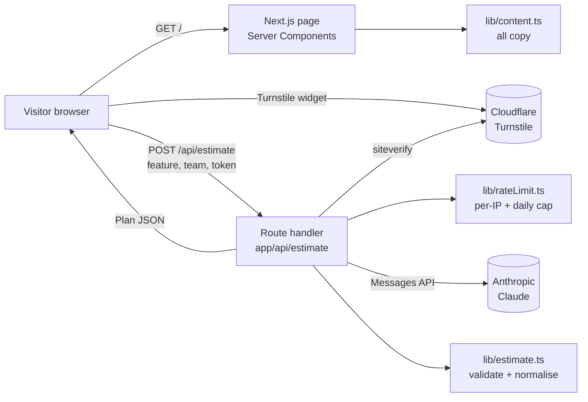

# 02 — Architecture

## Overview

## Request flow for the estimator
1. Visitor fills the form; the Turnstile widget produces a one-time token.
   `api.js` is not in the server HTML: the client injects it once the estimator is within 200px of the
   viewport or the form gets focus (on portrait phones that is right after hydration, since the
   estimator is in the first viewport).
2. Browser POSTs `{ feature, teamSize, seniority, token }` to `/api/estimate`.
3. Route handler, in this order: check content-type/size → parse JSON → `validateRequest` → Turnstile config guard (503 on production test keys / real secret without hostname) → API key present (503) → verify Turnstile → `checkLimits(ip)`
   → call Claude → parse JSON → `normalisePlan` (recomputes totals) → respond.
4. Browser renders the plan in two tabs and resets the Turnstile widget (tokens are single-use).

Order matters: cheap checks run before the paid call. Never move the Claude call earlier.

## File responsibilities

| Path | Responsibility | Status |
|---|---|---|
| `app/layout.tsx` | Fonts, metadata, theme bootstrap script | **Done** (OG, Twitter, canonical metadata) |
| `app/page.tsx` | Composes the bento grid from tiles | Skeleton |
| `app/opengraph-image.tsx`, `app/icon.tsx`, `app/apple-icon.tsx` | `next/og` image routes (1200x630 OG, 32px icon, 180px apple icon), static, display font from `app/fonts/` via `lib/ogFont.ts` | **Done** |
| `lib/tokens.ts` | Parses light and dark tokens from `app/globals.css`; used by the image routes and the contrast test | **Done** |
| `app/globals.css` | Design tokens, grid, base styles | Tokens done, layout skeleton |
| `app/api/estimate/route.ts` | Estimator endpoint (see 03) | **Done** |
| `lib/content.ts` | All site copy, from the CV | **Done** |
| `lib/estimate.ts` | Types, request validation, plan normalisation | **Done** |
| `lib/rateLimit.ts` | Per-IP limit and daily cap: Upstash when configured, in-memory fallback | **Done** |
| `lib/upstash.ts` | Upstash REST config and one-command client (ADR-009) | **Done** |
| `lib/timeline.ts` | Pure maths for the timeline chart and role totals | Skeleton + tests |
| `components/Bento.tsx` | Grid wrapper and `Tile` primitive (span props, `headingLevel`, `titleClassName`) | **Done** |
| `components/tiles/*` | One file per tile | Skeletons |
| `components/estimator/*` | Client UI for the demo | Skeletons |
| `components/ThemeToggle.tsx` | Light/dark icon toggle; follows the system until the visitor chooses | **Done** |
| `tests/unit/*` | Vitest | Started |
| `tests/e2e/*` | Playwright, AI call mocked with `page.route` | Started |

## Runtime notes
- Route handler runs on the Node.js runtime with `maxDuration = 60`.
- `lib/rateLimit.ts` shares the limits across instances in Upstash Redis over REST (`lib/upstash.ts`, hashed IPs) when its two env vars are set; without them, or when Upstash fails or is slow, it uses the per-instance in-memory limiter (best effort, never fail-open). See ADR-009.
- No database. No auth. Page-view analytics only: Vercel Web Analytics via a same-origin script, rendered on production builds only (ADR-008).
