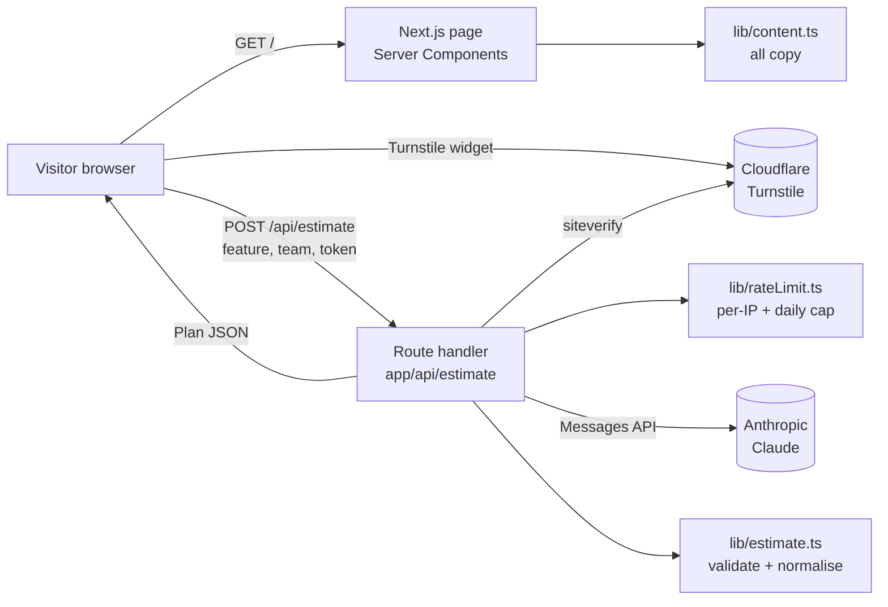

# 02 — Architecture

## Overview

## Request flow for the estimator
1. Visitor fills the form; the Turnstile widget produces a one-time token.
2. Browser POSTs `{ feature, teamSize, seniority, token }` to `/api/estimate`.
3. Route handler, in this order: parse JSON → `validateRequest` → `checkLimits(ip)` → verify Turnstile
   → call Claude → parse JSON → `normalisePlan` (recomputes totals) → respond.
4. Browser renders the plan in two tabs and resets the Turnstile widget (tokens are single-use).

Order matters: cheap checks run before the paid call. Never move the Claude call earlier.

## File responsibilities

| Path | Responsibility | Status |
|---|---|---|
| `app/layout.tsx` | Fonts, metadata, theme bootstrap script | **Done** (OG metadata is M5) |
| `app/page.tsx` | Composes the bento grid from tiles | Skeleton |
| `app/globals.css` | Design tokens, grid, base styles | Tokens done, layout skeleton |
| `app/api/estimate/route.ts` | Estimator endpoint (see 03) | **Done** |
| `lib/content.ts` | All site copy, from the CV | **Done** |
| `lib/estimate.ts` | Types, request validation, plan normalisation | **Done** |
| `lib/rateLimit.ts` | In-memory per-IP limit and daily cap | **Done** |
| `lib/timeline.ts` | Pure maths for the timeline chart and role totals | Skeleton + tests |
| `components/Bento.tsx` | Grid wrapper and `Tile` primitive (span props, `headingLevel`, `titleClassName`) | **Done** |
| `components/tiles/*` | One file per tile | Skeletons |
| `components/estimator/*` | Client UI for the demo | Skeletons |
| `components/ThemeToggle.tsx` | Light/dark icon toggle; follows the system until the visitor chooses | **Done** |
| `tests/unit/*` | Vitest | Started |
| `tests/e2e/*` | Playwright, AI call mocked with `page.route` | Started |

## Runtime notes
- Route handler runs on the Node.js runtime with `maxDuration = 60`.
- `lib/rateLimit.ts` is per serverless instance (best effort). Upgrade path: ADR-002.
- No database. No auth. No analytics until M5.
