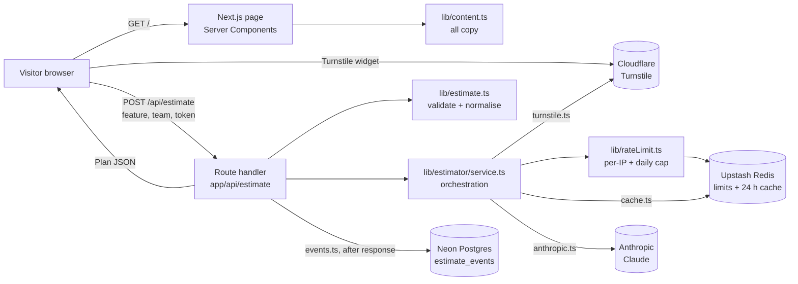

# 02 — Architecture

## Overview

## Request flow for the estimator
1. Visitor fills the form; the Turnstile widget produces a one-time token.
   `api.js` is not in the server HTML: the client injects it once the estimator is within 200px of the
   viewport or the form gets focus (on portrait phones that is right after hydration, since the
   estimator is in the first viewport).
2. Browser POSTs `{ feature, teamSize, seniority, token }` to `/api/estimate`.
3. Route handler (HTTP in, HTTP out): check content-type/size → parse JSON → `validateRequest` → Turnstile
   config guard (503 on production test keys / real secret without hostname) → API key present (503) →
   `runEstimate` in `lib/estimator/service.ts`: verify Turnstile → `checkLimits(ip)` → plan cache →
   call Claude → parse JSON → `normaliseScope` → cache the ok scope → respond `{ scope, inputs }`; the client runs `buildPlan` (ADR-013).
   The service takes its adapters as injected deps (`verifyHuman`, `checkLimits`, `cache`, `callModel`,
   `recordEvent`, `now`), so its unit tests use fakes. Every request logs one JSON line and, after the
   response (`after()`), writes one row to Neon (03, *Usage events*).
4. Browser renders the plan in two tabs and resets the Turnstile widget (tokens are single-use).

Order matters: cheap checks run before the paid call. Never move the Claude call earlier.

## File responsibilities

| Path | Responsibility | Status |
|---|---|---|
| `app/layout.tsx` | Fonts, metadata, theme bootstrap script | **Done** (OG, Twitter, canonical metadata) |
| `app/page.tsx` | Composes the bento grid from tiles | **Done** |
| `app/opengraph-image.tsx`, `app/icon.tsx`, `app/apple-icon.tsx` | `next/og` image routes (1200x630 OG, 32px icon, 180px apple icon), static, display font from `app/fonts/` via `lib/ogFont.ts` | **Done** |
| `app/favicon.ico` | `/favicon.ico` for tools that ask for it by name: the 32px `app/icon.tsx` PNG wrapped in an ICO. Rebuild it if the icon changes | **Done** |
| `lib/tokens.ts` | Parses light and dark tokens from `app/globals.css`; used by the image routes and the contrast test | **Done** |
| `app/globals.css` | Design tokens, grid, base styles | **Done** |
| `app/api/estimate/route.ts` | Estimator endpoint (see 03) | **Done** |
| `lib/content.ts` | All site copy, from the CV | **Done** |
| `lib/estimate.ts` | Types, request validation, scope normalisation | **Done** |
| `lib/estimateModel.ts` | Deterministic effort model: `buildPlan` applies seniority, AI band, working style and calendar to the model's scope (ADR-013) | **Done** |
| `lib/rateLimit.ts` | Per-IP limit and daily cap: Upstash when configured, in-memory fallback | **Done** |
| `lib/upstash.ts` | Upstash REST config and one-command client (ADR-009) | **Done** |
| `lib/estimator/service.ts` | Estimator orchestration with injected deps; outcomes and event rows | **Done** |
| `lib/estimator/turnstile.ts`, `anthropic.ts`, `cache.ts`, `events.ts` | Adapters: siteverify, Messages API, 24 h plan cache (Upstash), event rows and log line (Neon, ADR-012) | **Done** |
| `db/schema.sql` | DDL of the Neon `estimate_events` table | **Done** |
| `lib/estimator/events.ts` `usageStats()` | Page data source: 30-day stats (Neon) for the "How it's built" panel, revalidated hourly with `countPlans()` | **Done** |
| `lib/timeline.ts` | Pure maths for the timeline chart and role totals | **Done** |
| `components/Bento.tsx` | Grid wrapper and `Tile` primitive (span props, `headingLevel`, `titleClassName`) | **Done** |
| `components/tiles/*` | One file per tile | **Done** |
| `components/estimator/*` | Client UI for the demo | **Done** |
| `components/ThemeToggle.tsx` | Light/dark icon toggle; follows the system until the visitor chooses | **Done** |
| `tests/unit/*` | Vitest | Started |
| `tests/e2e/*` | Playwright, AI call mocked with `page.route` | Started |

## Runtime notes
- Route handler runs on the Node.js runtime with `maxDuration = 60`.
- `lib/rateLimit.ts` shares the limits across instances in Upstash Redis over REST (`lib/upstash.ts`, hashed IPs) when its two env vars are set; without them, or when Upstash fails or is slow, it uses the per-instance in-memory limiter (best effort, never fail-open). See ADR-009.
- **Upstash vs Neon:** Upstash Redis holds short-lived data that expires on its own (rate-limit hits, the
  24-hour plan cache). Neon Postgres holds durable usage rows queried with SQL (ADR-012). Both are optional:
  without their env vars the limiter falls back to memory, the cache is off and no rows are written.
- No auth. Page-view analytics only: Vercel Web Analytics via a same-origin script, rendered on production builds only (ADR-008).
